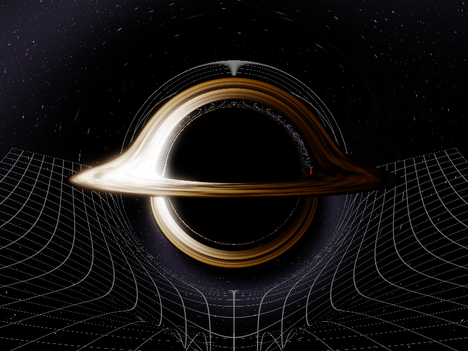

# blackhole-sim

A real-time black hole renderer written in C++ and OpenGL. Every pixel is a
light ray traced backwards through curved spacetime on the GPU, so the
lensing, the warped accretion disk and the black hole's shadow all come out of
the physics rather than being painted on.



Based on [kavan010/black_hole](https://github.com/kavan010/black_hole) and
[its video](https://youtu.be/8-B6ryuBkCM), with a faster integrator and extra
relativistic effects.

## Features

- **Geodesic ray tracing** in a compute shader. Light paths follow the
  Schwarzschild metric, integrated with RK4 and an adaptive step size.
- **Gravitational lensing.** The far side of the disk appears above and below
  the hole, the photon ring is visible, and the starfield is distorted
  around it.
- **Relativistic accretion disk.** Orbiting gas with Doppler beaming (the side
  moving toward you is brighter and bluer) and gravitational redshift.
  Blackbody colours, with a temperature profile that is hotter toward the
  inner edge.
- **Animated gas.** A procedural texture with differential rotation: inner
  rings orbit faster than outer ones.
- **HDR bloom and ACES tone mapping.**
- **Ray-traced spacetime grid.** The black hole's embedding diagram (Flamm's
  paraboloid) is drawn as a grid that light rays actually hit, so it is
  lensed, wraps around the shadow, and is hidden behind the hole.
- **N-body gravity.** Stars fall toward the hole and are swallowed at the
  event horizon.
- **Reference mode** (press `D`) that reproduces the flat orange disk from the
  original project.

## Controls

| Input | Action |
|---|---|
| Left-drag | Orbit the camera |
| Scroll | Zoom |
| `G` / hold right mouse | Toggle gravity / gravity while held |
| `D` | Relativistic disk ↔ reference flat disk |
| `B` | Starfield on/off |
| `L` | Bloom on/off |
| `T` | Grid: ray traced → off → flat overlay (reference) |
| `P` | Save a screenshot (`screenshot_<time>.bmp`) |
| `Esc` | Quit |

The window title shows the FPS and whether gravity is on.

## Building (Windows, MSVC)

Requirements: Visual Studio 2022 or the Build Tools with the C++ workload,
and a GPU with OpenGL 4.3 (needed for compute shaders).

```bat
git clone --recursive https://github.com/yubyunghun/blackhole-sim.git
cd blackhole-sim
```

`--recursive` also fetches GLM, which is a git submodule. If you already
cloned without it, run `git submodule update --init`.

Then, from the **x64 Native Tools Command Prompt for VS 2022**:

```bat
build_msvc.bat
run.bat
```

GLAD and prebuilt GLFW binaries are included in `third_party/`.

### Command-line options

```
main.exe [--screenshot out.bmp [frames]] [--gravity] [--flat-disk] [--no-stars]
         [--no-bloom] [--grid ray|off|overlay]
```

`--screenshot` renders the given number of frames (default 20), saves the last
one and exits. It's useful for testing.

## How it works

Everything is in [`src/main.cpp`](src/main.cpp), including the shaders.

1. **Ray setup.** For each pixel, a compute shader builds a ray from the
   camera.
2. **Integration.** A photon's path in Schwarzschild spacetime obeys
   `d²x/dλ² = −1.5 · rs · h² · x / r⁵`, where `h = |x × v|` is conserved.
   This gives the same trajectories as the full geodesic equations, but in
   Cartesian coordinates (no singularity at the poles). It is integrated with
   RK4 in units of `rs` (so `r⁵` fits in a 32-bit float), using a step of 2%
   of the current radius.
3. **Hits.** Each step is tested against the disk plane (interpolated to the
   exact crossing point), the stars (segment–sphere test), and the event
   horizon. Rays that escape sample the starfield in their final direction.
   The grid surface `y = y₀ + 2·√(rs·(d − rs))` is tested on every step too.
   Grid lines are blended in front to back and the ray keeps going, so
   whatever lies behind still shows through the gaps.
4. **Disk shading.** `g = Doppler × gravitational` shift. Observed intensity
   scales as `g⁴` and observed temperature as `g · T`.
5. **Post-processing.** The HDR image goes through a bright pass, a two-scale
   Gaussian blur and ACES tone mapping. The result is blended over the grid.
