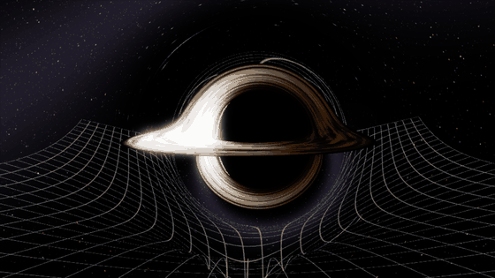
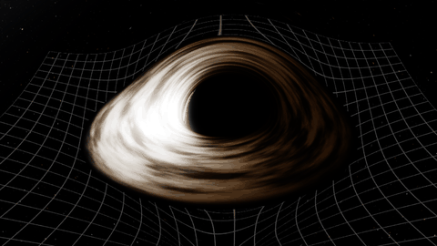
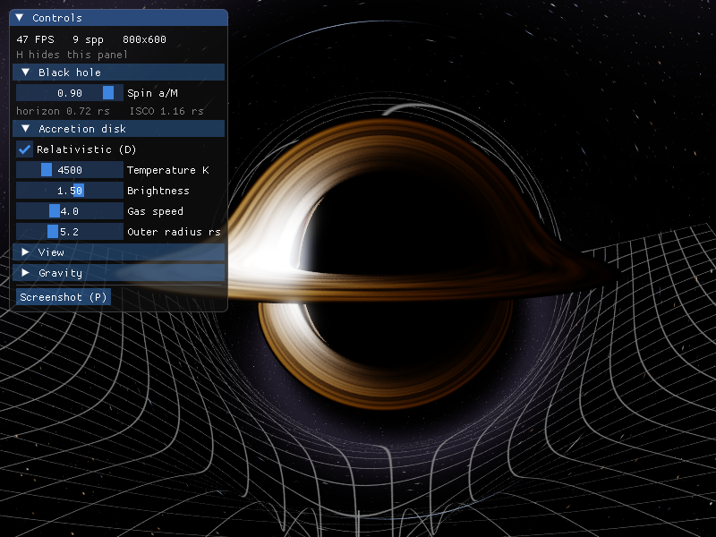
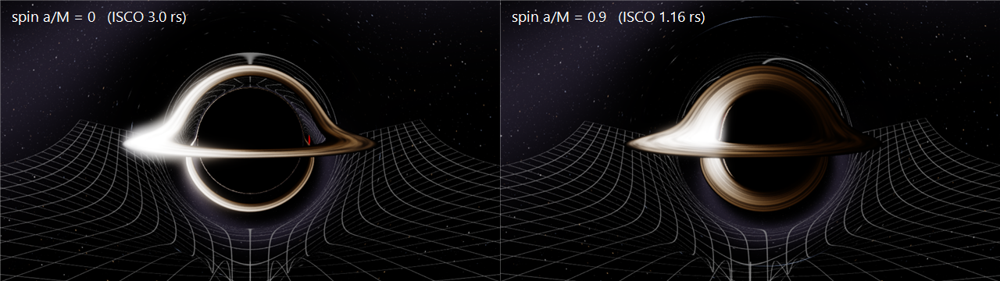

# blackhole-sim

A real-time black hole renderer written in C++ and OpenGL. Every pixel is a
light ray traced backwards through curved spacetime on the GPU, so the
lensing, the warped accretion disk and the black hole's shadow all come out of
the physics rather than being painted on.





Based on [kavan010/black_hole](https://github.com/kavan010/black_hole) and
[its video](https://youtu.be/8-B6ryuBkCM), with a faster integrator and extra
relativistic effects.

## Features

- **Spinning (Kerr) black hole.** Light paths follow the Kerr metric for any
  spin from 0 (non-rotating) to 0.99. Frame dragging produces the
  off-centre, D-shaped shadow, and the disk's inner edge moves in to the
  innermost stable orbit.
- **Geodesic ray tracing** in a compute shader, integrated with RK4 and an
  adaptive step size.
- **Gravitational lensing.** The far side of the disk appears above and below
  the hole, the photon ring is visible, and the starfield is distorted
  around it.
- **Relativistic accretion disk.** A **Novikov–Thorne** thin disk, the
  standard general-relativistic disk model. It starts at the innermost stable
  orbit, with a spin-dependent temperature profile. On top of that:
  - Doppler beaming (the side moving toward you is brighter and bluer)
  - frame dragging
  - gravitational redshift
  - blackbody colours

  Colour and brightness both follow from `g·T`.
- **Relativistic camera.** Pixel directions are measured in a static
  observer's local frame, so aberration near the hole is correct. The shadow
  size matches the analytic formula (see [Physics](#physics)).
- **Dive into the black hole** (`F`). The camera is let go and follows a
  free-fall geodesic. It crosses the event horizon and keeps rendering from
  inside, with the light blueshifted by its own motion, until it reaches the
  singularity (spin 0) or the inner horizon (spinning hole). Exposure adapts
  automatically during a dive.
- **Animated gas.** A procedural texture with differential rotation: inner
  rings orbit faster than outer ones.
- **HDR bloom and ACES tone mapping.**
- **Progressive rendering.** A quick low-res preview while you move the
  camera. When it stops, the full-res image is refined over the next frames
  with jittered samples (anti-aliasing), tracing only a quarter of the pixels
  per frame so it stays at 60 FPS.
- **Ray-traced spacetime grid.** The black hole's embedding diagram (Flamm's
  paraboloid) is drawn as a grid that light rays actually hit, so it is
  lensed, wraps around the shadow, and is hidden behind the hole.
- **N-body gravity.** Stars fall toward the hole and are swallowed at the
  event horizon, or can be put on circular orbits.
- **Resizable window and fullscreen** (`F11`). The ray-traced resolution
  follows the window. **Auto resolution** caps it at about 0.5 megapixels so
  large and fullscreen windows stay smooth, and a render-scale slider trades
  speed for sharpness.
- **Reference mode** (press `D`) that reproduces the flat orange disk from the
  original project.
- **Video look** (press `V`) that matches the original project's video. It
  uses:
  - the flat orange disk, with colours sampled from the video
  - a 200×150 pixelated render, stretched from 4:3 to 16:9 like the video
    (exact in a 16:9 window)
  - the overlay grid, the slate background and the same camera angle

  Turning it off restores your settings.

## Controls

A control panel (top-left; **H** hides it) has:
- sliders for the spin, disk peak temperature, brightness, gas speed, disk
  size, bloom, exposure and gravity time scale
- a **Physics** readout for the current spin (horizon, ergosphere, photon
  orbits, ISCO, peak-flux radius, radiative efficiency, horizon rotation
  period) and a **Relativistic camera** toggle to compare with plain
  coordinate directions
- **Orbit stars** (puts the stars on circular orbits) and **Reset scene**
  buttons
- a **Display** section with fullscreen, auto resolution and render scale

The window can be resized freely.



| Input | Action |
|---|---|
| Left-drag | Orbit the camera |
| Scroll | Zoom |
| `[` / `]` | Decrease / increase spin (0 – 0.99) |
| `G` / hold right mouse | Toggle gravity / gravity while held |
| `D` | Relativistic disk ↔ reference flat disk |
| `B` | Starfield on/off |
| `L` | Bloom on/off |
| `T` | Grid: ray traced → off → flat overlay (reference) |
| `P` | Save a screenshot (`screenshot_<time>.bmp`, without the panel) |
| `H` | Show/hide the control panel |
| `V` | Video look on/off (match the original video) |
| `F11` | Fullscreen on/off |
| `F` | Dive into the black hole / stop the dive |
| `F5` | Reload the shaders from disk (edit GLSL without restarting) |
| `Esc` | Quit |

The window title shows the FPS, the effective samples per pixel, the spin,
and whether gravity is on.

## Download (Windows)

Prebuilt Windows builds are on the
[Releases page](https://github.com/yubyunghun/blackhole-sim/releases). Unzip
and run `blackhole_sim.exe`. The C++ runtime is built in, so no installs are
needed, but the GPU must support OpenGL 4.3.

To make a release zip yourself, run this from a VS 2022 x64 Native Tools
prompt with CMake installed:

```bat
powershell -ExecutionPolicy Bypass -File scripts/package_release.ps1 -Version 1.0.0
```

This writes `dist/blackhole-sim-1.0.0-win64.zip`, containing the exe,
`shaders/`, the README and the licenses.

## Building

Requirements:
- a C++17 compiler
- a GPU with OpenGL 4.3 (needed for compute shaders)

```bat
git clone --recursive https://github.com/yubyunghun/blackhole-sim.git
cd blackhole-sim
```

`--recursive` also fetches GLM and Dear ImGui, which are git submodules. If
you already cloned without it, run `git submodule update --init`.

### CMake (Windows or Linux)

```bash
cmake -S . -B build -DCMAKE_BUILD_TYPE=Release
cmake --build build --config Release
```

- **Windows:** uses the prebuilt GLFW in `third_party/`.
- **Linux:** uses the system GLFW (`sudo apt install libglfw3-dev`).

The executable is `build/blackhole_sim` (on Windows, `build/Release/` with
Visual Studio generators), with the shaders copied next to it. On Windows
you can add `-DBH_STATIC_RUNTIME=ON` to build the C++ runtime into the exe,
and on Windows-on-ARM add `-A x64`, because the bundled GLFW is x64. The CMake build
is tested with MSVC + Ninja; Linux is set up but untested. macOS isn't
supported because it stops at OpenGL 4.1, which has no compute shaders.

### Windows without CMake

From the **x64 Native Tools Command Prompt for VS 2022**:

```bat
build_msvc.bat
run.bat
```

This builds `main.exe` in the repo root. GLAD and prebuilt GLFW binaries are
included in `third_party/`.

### Command-line options

```
main.exe [--screenshot out.bmp [frames]] [--shot-ui] [--spin 0..0.99] [--gravity]
         [--orbit] [--flat-disk] [--no-stars] [--no-bloom] [--grid ray|off|overlay]
         [--no-ui] [--video-look] [--size WxH] [--fullscreen] [--coord-camera]
         [--time seconds] [--record folder [frames]] [--camera distance_rs elevation_deg]
         [--dive] [--dive-to r_rs]
main.exe --physics
```

`--screenshot` renders the given number of frames (default 20), saves the last
one and exits. It's useful for testing. `--shot-ui` includes the panel in the
screenshot, and `--orbit` starts with the stars on circular orbits. `--size`
sets the starting window size (default `1280x720`). `--time` freezes the gas
animation clock at the given time, so renders are repeatable.

`--record <folder> [frames]` flies the camera once around the hole (default 72
frames). It saves `frame_0000.bmp`, … with each frame refined over 12
progressive passes, and the animation clock advances 1/15 s per frame.
That's how [`docs/demo.gif`](docs/demo.gif) was made:

```bat
main.exe --record frames 72
```

With `--dive`, the recorder follows the fall instead, one frame per 3%
closer to the hole. That's [`docs/dive.gif`](docs/dive.gif):

```bat
main.exe --camera 10 25 --dive --record frames
```

`--camera` sets the starting distance (in rs) and the elevation above the
disk (in degrees). `--dive-to 0.6` falls to r = 0.6 rs and holds there, which
is useful for screenshots inside the horizon. `--coord-camera` turns off
the relativistic camera. `--physics` prints the table of Kerr radii and
efficiencies below and exits.

## Testing

The project has two layers of checks:

- **Physics self-test** (`bh_tests`, no GPU needed). It runs 29 checks of the
  CPU-side physics against published values and exact identities:
  - Kerr horizon, photon orbits, ISCO and efficiency for several spins
  - Novikov–Thorne flux: zero at the ISCO, ~r⁻³ far out, peak at 9.55M
  - the camera tetrad is orthonormal under the Kerr metric, and pixel photons
    are null
  - the analytic shadow size, the gravitational blueshift a hovering camera
    sees, and that a free-falling camera stays on its mass shell

  It's built by both build systems. Run `ctest` (CMake) or `bh_tests.exe`.
  **GitHub Actions** builds on Windows and Linux and runs it on every push.
- **Render checks** (`scripts/run_checks.ps1`, needs a GPU, run locally):
  - renders four reference views (flat reference, video look, Kerr flat,
    full relativistic with the animation clock frozen by `--time`) and
    compares them to [`tests/golden/`](tests/golden), with a tolerance for
    GPU differences
  - measures the shadow radius against theory (134.2 px)

  After an intended visual change, run it with `-UpdateGolden`.

```bat
powershell -ExecutionPolicy Bypass -File scripts/run_checks.ps1
```

Pushing a version tag (`git tag v1.0.0 && git push origin v1.0.0`) makes
GitHub Actions build the Windows zip and publish it as a Release.

## Physics

Units: `rs = 2GM/c²` is the Schwarzschild radius, `M = rs/2`, and `a* = a/M`
is the spin.

**Characteristic radii.** These are computed for the current spin and shown
in the panel. The output of `main.exe --physics` matches the standard Kerr
values: horizon `M(1 + √(1 − a*²))`, ISCO 6M → 1.45M at a* = 0.99, and
efficiency 5.7% → 26.4%.

| a/M | horizon | ergosphere (eq.) | photon orbit pro / retro | ISCO | peak disk flux | efficiency |
|---|---|---|---|---|---|---|
| 0.00 | 1.000 rs | 1.000 rs | 1.500 / 1.500 rs | 3.000 rs | 4.775 rs | 5.7 % |
| 0.50 | 0.933 rs | 1.000 rs | 1.174 / 1.766 rs | 2.117 rs | 3.307 rs | 8.2 % |
| 0.90 | 0.718 rs | 1.000 rs | 0.779 / 1.955 rs | 1.160 rs | 1.720 rs | 15.6 % |
| 0.99 | 0.571 rs | 1.000 rs | 0.584 / 1.996 rs | 0.727 rs | 0.988 rs | 26.4 % |

**Novikov–Thorne disk (Page & Thorne 1974).** A thin, optically thick disk
with no torque at the ISCO radiates a flux

```
F(r) ∝ 1 / (x⁴ (x³ − 3x + 2a*)) · [ x − x₀ − (3/2) a* ln(x/x₀)
        − Σᵢ 3(xᵢ − a*)² / (xᵢ (xᵢ − xⱼ)(xᵢ − xₖ)) · ln((x − xᵢ)/(x₀ − xᵢ)) ]
```

Here `x = √(r/M)`, `x₀ = √(r_isco/M)`, and `x₁, x₂, x₃` are the roots of
`x³ − 3x + 2a* = 0`. Each ring is a blackbody with `T ∝ F^¼`. A blackbody
seen with frequency shift `g` is a blackbody at `g·T`, so the colour is
`blackbody(g·T)` and the brightness is `∝ g⁴·F`. The flux is zero at the
ISCO, which is why the inner edge glows faintly while the brightest gas sits
just outside it. With spin 0 the disk starts at 3 rs, leaving a dark gap
around the shadow. At spin 0.9 it reaches 1.16 rs.



**Relativistic camera.** The camera is a static observer, or during a dive a
freely falling one. Its local frame (tetrad) is built by Gram–Schmidt under
the Kerr–Schild metric. A pixel looking in direction `n` in that frame
receives the photon `p = u − (nᵣ eᵣ + nᵤ eᵤ + n_f e_f)`, which is then traced
backwards in time. The photon's energy measured by the camera, `−p·u`, sets
the camera's part of the redshift.

**Inside the horizon.** The tracer works in *ingoing* Kerr–Schild
coordinates, which are smooth across the event horizon, so the camera can be
inside it. Two points matter there:
- `∂ₜ` becomes spacelike inside the horizon, so a photon's Killing energy
  `E = −p_t` can be negative. The tracer keeps its sign (`|E| = 1`) rather
  than assuming E > 0.
- From inside, rays that run backwards up against the horizon without
  crossing it come from the past horizon ("white hole") of the eternal
  solution. In a real collapse that is the collapsing star, so they are
  rendered dark. They are recognised by `S = E + k·p` blowing up.

*Check:* for spin 0 at the default distance (11.81 rs), a static observer
should see a shadow of angular radius
`sin α = (3√3/2)(rs/r)·√(1 − rs/r)`, i.e. α = 12.15°, or **134.2 px** at
720 px tall. The renderer measures **133–135 px**. Plain coordinate
directions (the previous camera, still available with `--coord-camera`) give
141–143 px, about 5% too large.

## License

The code in this repository is released under the [MIT License](LICENSE). It
began as a port of [kavan010/black_hole](https://github.com/kavan010/black_hole).
Third-party libraries keep their own licenses: see
[third_party/LICENSES.md](third_party/LICENSES.md).

## How it works

| File | What's in it |
|---|---|
| [`src/shaders/geodesic.comp`](src/shaders/geodesic.comp) | **The ray tracer:** Kerr geodesics, disk, stars, grid, sky |
| [`src/physics.cpp`](src/physics.cpp) | Kerr radii, Novikov–Thorne flux, N-body gravity |
| [`src/render.cpp`](src/render.cpp) | Shader loading, render targets, progressive rendering, camera tetrad, bloom |
| [`src/ui.cpp`](src/ui.cpp) | The control panel |
| [`src/main.cpp`](src/main.cpp) | Window, input, command line, main loop |
| [`src/common.hpp`](src/common.hpp) | Shared settings and declarations |
| `src/shaders/*.vert, *.frag` | Fullscreen blit, overlay grid, bloom and composite passes |

Shaders are loaded at runtime from `shaders/` next to the executable, or from
`src/shaders/`. Press **F5** to reload them after editing. If one fails to
compile, the error is printed and the old shaders keep running.

1. **Ray setup.** For each pixel, a compute shader builds a photon from the
   camera's local frame (see [Physics](#physics)).
2. **Integration.** Rays are integrated in **Kerr–Schild coordinates**.
   These are Cartesian, smooth across the horizon, and have no singularity
   at the poles. The metric is `g = η + f·k⊗k`, so the photon Hamiltonian is
   `H = ½(−1 + |p|² − f·(1 + k·p)²)`. Hamilton's equations, with analytic
   gradients of `f` and `k`, are stepped with RK4 in units of `rs`. The step
   is 2% of the radius near the hole, growing to 8% far away.
   - Rays are traced backwards in time (negative steps), from the photon
     arriving at the camera, in ingoing coordinates, so the camera can also
     be inside the horizon.
   - Near the horizon the step shrinks with the distance to it, and a ray
     from outside that is within 2% of the horizon and still heading in is
     counted as shadow (below the photon orbit it can't come back out).
   - With spin 0 this reduces exactly to Schwarzschild.
3. **Hits.** Each step is tested against the disk plane (interpolated to the
   exact crossing point), the stars (segment–sphere test), and the event
   horizon. Rays that escape sample the starfield in their final direction.
   The grid surface `y = y₀ + 2·√(rs·(d − rs))` is tested on every step too.
   Grid lines are blended in front to back and the ray keeps going, so
   whatever lies behind still shows through the gaps.
4. **Disk shading.** For gas on circular Kerr orbits, the redshift is
   `g = E_cam / (uᵗ · (E − Ω·L))`, where `E_cam = −p·u_cam` is the photon
   energy the camera measures (`1/√(1−f)` for a hovering camera, which sits
   deeper in the potential and so sees light blueshifted). This single
   factor includes Doppler beaming, frame dragging, gravitational redshift
   and the camera's own motion. The emitted
   temperature follows the Novikov–Thorne flux. Observed colour is a
   blackbody at `g·T`, and brightness scales as `g⁴·F`.
5. **Progressive refinement.** The image size is the window size × the
   render scale. While the camera moves, a half-size preview is traced every
   frame. With the camera still, each frame traces one
   pixel of every 2×2 block, cycling through the four. Each sample is shot
   through a jittered sub-pixel position (Halton sequence) and blended into a
   running average. The blend weight never drops below 0.2, so the animated
   gas stays sharp. Any change to the view or settings restarts the average.
6. **Post-processing.** The HDR image goes through a bright pass, a two-scale
   Gaussian blur and ACES tone mapping. The result is blended over the grid.
